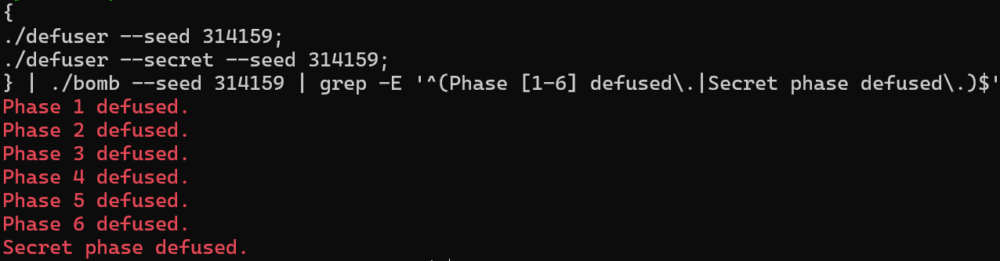

# BombLab 实验报告

## 实验说明

本实验要求根据每关收到的 64 位 `challenge` 计算口令。前六关输出若干个无符号十进制整数；Honor 还要结合驱动提供的 `context`，生成符合检查条件的一行文本。实验 README 将 Honor 列为必做部分。

我在 WSL 中编译求解程序，并运行了 `public_test.py`，六关和 Honor 均通过。随后，我用公开列表之外的 seed 314159 验证了原版 `bomb`。下面结合最终代码说明各关的检查条件、计算关系和实现方法。

本文对应 WSL 项目 `/home/xyzet/os-course/BombLab/defuser.c` 中的最终代码。程序运行在 WSL2 的 Linux x86_64 环境中，内核版本为 `5.15.167.4-microsoft-standard-WSL2`，编译器为 GCC 13.3.0。Makefile 的编译选项为：

```text
-std=c11 -O2 -Wall -Wextra -Wpedantic -Werror
```

## 分析中使用的约定

以下用 $C$ 表示 `challenge`，用 $U(x)$ 表示保留 $x$ 的低 32 位，即模 $2^{32}$；$\oplus$ 表示按位异或。汇编写入 `%eax`、`%edi` 等 32 位寄存器时，会清零高 32 位，计算关系中也要保留相应的截断。C 实现主要使用 `uint32_t` 和带 `u` 后缀的常量，保留无符号回绕运算的结果。

在 System V AMD64 调用约定下，前几个整数参数依次通过 `%rdi`、`%rsi`、`%rdx`、`%rcx` 等寄存器传递，结果通常由 `%eax` 返回。AT&T 语法中源操作数在前、目的操作数在后，例如 `sub %esi,%edi` 表示 `edi = edi - esi`。`lea` 在本实验中经常用于乘加计算，不一定表示访问内存。

常规关卡在解析前调用 `valid_u32_fields`。该函数在 `0x402cb2–0x402ce9` 检查十进制数字及 32 位溢出，在 `0x402cf8–0x402d28` 检查分隔和末尾。输入既要满足 `sscanf` 的转换次数，也要符合数字个数、范围和尾随内容的要求。

最终代码沿用模板的 `write_answer`，根据 `values` 和 `count` 输出空格分隔的无符号十进制整数，不附带调试信息或换行。

## 第 1 关：辅助函数之间的参数传递

### 关键检查与推导

`phase_01` 在 `0x40209d` 把字段数设为 1，再调用合法性检查。`0x4020c6` 使用 `0x403189` 处的 `%u` 格式串，`0x4020d3` 要求转换一个整数。

随后，`0x4020d8–0x4020e3` 将 challenge 传给 `p1_compute`，比较输入值与返回结果。本关的口令就是这个计算值。

`p1_compute` 首先准备三个片段：

$$
L=U(C),\qquad H=U(C\gg32),\qquad M=U(C\gg16).
$$

其中，`0x40205d` 将副本右移 32 位，`0x402064` 将另一个副本右移 16 位。截断后，$M$ 包含原值的第 16 至 47 位。

辅助函数的关键指令为：

```asm
402044: lea    (%rdi,%rdi,4),%eax
402047: add    $0xaa85,%esi
40204d: xor    %esi,%eax

402024: lea    (%rdi,%rsi,2),%eax
402027: xor    $0x4c35,%eax

402034: sub    %esi,%edi
402036: lea    0xe82(%rdi,%rdi,4),%eax
```

按调用前寄存器的赋值顺序，`0x40206d` 调用 `p1_step2(H,L)`，得到：

$$
T=U(5H)\oplus U(L+0xaa85).
$$

之后 `0x402072–0x40207a` 用 $L$ 和右移 16 位的片段调用 `p1_step0`，并将 $T$ 保存到 `%ecx`：

$$
A=U(L+2M)\oplus0x4c35.
$$

最后 `0x40207f–0x402083` 调用 `p1_step1(A,T)`，先相减，再乘 5 加常数：

$$
\boxed{R=U\left(5U(A-T)+0xe82\right).}
$$

三个辅助函数如何衔接，取决于调用前的寄存器赋值。减法也按无符号整数处理，保留回绕后的结果。

### 最终实现

`solve_phase_1` 用 `lo`、`hi`、`mid` 保存上述片段，再计算 `t`、`a` 和最终结果。结果写入 `values[0]`，设置 `count=1`。其中的 `uint32_t` 变量对应汇编的低 32 位运算。

## 第 2 关：六项数组与递推循环

### 字段数量和初值

`0x4020fd` 将合法性检查的字段数设为 6；`0x402132` 使用的格式串是六个 `%u`，`0x402155` 要求成功转换六项。六个整数按顺序存放在 `rbp-0x40` 至 `rbp-0x2c`，每项占 4 字节。

初值检查为：

```asm
40215a: mov    %r13,%rax
40215d: mov    -0x40(%rbp),%esi
402160: shr    $0x23,%rax
402164: movzbl %al,%eax
402167: cmp    %eax,%esi
```

`0x23` 是 35，`movzbl %al,%eax` 只保留右移后的最低字节，因此：

$$
\boxed{x_0=(C\gg35)\mathbin{\&}255.}
$$

### 后五项的关系

循环从 `%edx=1`、`%ecx=22` 开始，关键指令为：

```asm
402178: lea    0x5(%rdx),%edi
40217b: lea    (%rsi,%rsi,4),%esi
40217e: shr    %cl,%rax
402181: and    $0x3f,%eax
402184: xor    %edi,%eax
402186: add    %esi,%eax
402188: mov    -0x40(%rbp,%rdx,4),%esi
40218c: cmp    %eax,%esi
```

每轮把上一项乘 5，作为第一部分。第二部分从原 challenge 中取 6 位，与“项号加 5”的结果异或，然后将两部分相加。`0x402190` 将下标加 1，`0x402194` 将移位数加 3；下标到 6 时退出。由此得到：

$$
\boxed{x_i=U\left(5x_{i-1}+\left(((C\gg(19+3i))\mathbin{\&}63)\oplus(i+5)\right)\right),\quad i=1,\ldots,5.}
$$

五次移位数分别是 22、25、28、31、34，每轮都重新从原 challenge 取位。比较通过后，`%esi` 中的实际输入等于本项期望值，下一轮就用它作为前项。

### 最终实现

`solve_phase_2` 设置 `count=6`，先计算 `values[0]`，再通过 `i=1` 至 5 的循环生成后五项，与汇编中的数组下标和递推顺序对应。

## 第 3 关：跳转表与分支映射

### 两个输出字段

`0x4022ad` 要求两个整数。`0x4022ec–0x4022f7` 将第一个整数与 challenge 的低 3 位比较：

$$
a=C\mathbin{\&}7.
$$

随后 `0x4022ff` 右移 3 位，`0x402303` 右移另一副本 32 位，`0x402307` 异或低 32 位，得到分支参数：

$$
z=U(C\gg3)\oplus U(C\gg32).
$$

第二个输入应等于 `p3_dispatch(a,z)` 的返回值，比较位置在 `0x40230e–0x402311`。

### 从原始表项确定真实分支

`p3_dispatch` 在 `0x402244–0x402246` 把编号放入 `%eax`，把运算参数放入 `%edi`，随后执行：

```asm
402248: cmp    $0x7,%eax
40224b: ja     402295
40224d: notrack jmp *0x405820(,%rax,8)
```

比例因子为 8，说明每个表项是 8 字节指针。原始数据中的 `68224000 00000000` 按小端序解释为 `0x402268`，该地址又跳转到 `p3_case_3`，而不是 `p3_case_0`。函数名后缀与表项编号并不直接对应，需要逐项追踪跳转目标。

| 编号 | 表中指针 | 最终函数入口 | 第二个输出值 |
|---:|---|---|---|
| 0 | `0x402268` | `0x4021e0` | $U(2z)\oplus0xe209$ |
| 1 | `0x402270` | `0x402210` | $U(5z+0x97d5)$ |
| 2 | `0x402278` | `0x4021f0` | $U(5z+0x3307c)$ |
| 3 | `0x402280` | `0x402200` | $U(2z)\oplus0x2368$ |
| 4 | `0x402288` | `0x4021c0` | $U(5z+0x21cc3)$ |
| 5 | `0x402290` | `0x4021d0` | $U(5z+0xaef1)$ |
| 6 | `0x402258` | `0x4021b0` | $U((z\oplus0xfe64)+(z\gg1))$ |
| 7 | `0x402260` | `0x402220` | $U((z\oplus0x5cd)+(z\gg2))$ |

最后两个分支先把原值复制到 `%eax`，再右移 `%edi`。因此，加法中使用的是原始 $z$ 的右移结果。乘 5 的分支则由 `lea 常数(%rdi,%rdi,4),%eax` 得到。

### 最终实现

`solve_phase_3` 设置 `count=2`，将编号保存到 `values[0]`。八分支 `switch` 按上表计算第二个数字，保存到 `values[1]`。代码中的 `switch` 顺序与解码后的跳转表一致。

## 第 4 关：二分递归与返回值回代

### 参数和递归终点

`0x40239d` 要求一个整数。`0x4023d8–0x4023f5` 准备 `p4_walk` 的四个参数：

$$
t=C\mathbin{\&}127,\qquad k=U(C\gg7)\oplus U(C\gg32),
$$

调用形式为 $W(t,0,127,k)$。其中 $t$ 是内部搜索目标，输入的口令应是递归返回值，不是 $t$ 本身。

函数开头先保存目标，再计算中点：

```asm
402324: mov    %edi,%eax
402326: mov    %edx,%edi
402328: sub    %esi,%edi
40232a: shr    $1,%edi
40232c: add    %esi,%edi
40232e: cmp    %eax,%edi
402330: je     402380
```

设当前闭区间为 $[l,h]$，则：

$$
m=l+\left\lfloor\frac{h-l}{2}\right\rfloor.
$$

命中目标时，`0x402380` 加上 `0xc9`，`0x402386` 与 salt 异或，返回 $U(m+201)\oplus k$。

### 左右递归及回代关系

未命中时，`0x402337` 将 $U(m+k)$ 存入 `%ebx`。`0x40233e` 是 `cmp %edi,%eax`，随后的 `jb` 表示无符号目标小于中点，进入左分支。

- 左分支在 `0x402360` 把上界改为 $m-1$，`0x402365` 递归；返回后 `0x40236a` 乘 3，`0x40236d` 异或保存值，`0x402374` 再异或 6。
- 右分支在 `0x402342` 把下界改为 $m+1$，`0x402347` 递归；返回后同样乘 3 并异或保存值，最后在 `0x402356` 异或 `0x17`，即十进制 23。

因此递归关系是：

$$
W(t,l,h,k)=
\begin{cases}
U(m+201)\oplus k,&t=m,\\
U(3W(t,l,m-1,k))\oplus U(m+k)\oplus6,&t<m,\\
U(3W(t,m+1,h,k))\oplus U(m+k)\oplus23,&t>m.
\end{cases}
$$

目标一定在初始区间内，每次都保留目标所在的半边，因此会终止。最深路径经过 8 个节点，例如目标 127 的中点序列为 `63,95,111,119,123,125,126,127`。

### 最终实现

最终 `solve_phase_4` 用 `keys[8]` 和 `branches[8]` 两个局部数组模拟调用栈。向下搜索时，记录每层的 `mid+salt`，以及左侧常数 6 或右侧常数 23。命中目标后先算终点值，再按 `depth` 逆序取出记录，执行乘 3 和异或，顺序与递归返回过程相同。

最多需要保存 7 个未命中节点，长度为 8 的数组足够。输出只有一个结果，`count=1`。整个计算分成向下保存搜索路径和从叶到根回代两步。

## 第 5 关：节点布局和链表遍历

### 两个字段的用途

`0x40247d` 要求两个整数。`0x4024bc–0x4024c3` 调用 `p5_traverse(challenge,&last)` 后，`0x4024cc` 将第一个输入与返回的 `%eax` 比较，`0x4024d1–0x4024d7` 将第二个输入与 `last` 比较。两个输出依次为混合结果和最后节点的 tag。

遍历函数的关键访存为：

```asm
402437: mov    0x4(%rdx),%esi
40243c: xor    (%rdx),%eax
402454: mov    0x8(%rdx),%rdx
40245e: xor    (%rdx),%eax
402460: add    %esi,%eax
402462: mov    %esi,(%r8)
```

这些访存的宽度和偏移表明，每个节点占 16 字节：偏移 0 为 32 位 value，偏移 4 为 32 位 tag，偏移 8 为 64 位 next 指针。这里用 tag 称呼第二个字段，不额外假定其含义。

### 原始数据的解码

以 `0x405ba0` 的数据 `c47a0000 46060000 005c4000 00000000` 为例，小端解释后是 `value=0x7ac4`、`tag=0x646`、`next=0x405c00`。全部节点如下：

| 地址 | value | tag | next |
|---|---|---|---|
| `0x405ba0` | `0x7ac4` | `0x646` | `0x405c00` |
| `0x405bb0` | `0x3697` | `0x820` | `0x405c30` |
| `0x405bc0` | `0x3531` | `0x15a` | NULL |
| `0x405bd0` | `0x8f61` | `0x445` | `0x405c40` |
| `0x405be0` | `0x3338` | `0x331` | `0x405c50` |
| `0x405bf0` | `0x209d` | `0x977` | `0x405c20` |
| `0x405c00` | `0x27db` | `0x272` | `0x405bf0` |
| `0x405c10` | `0x4024` | `0x516` | `0x405bb0` |
| `0x405c20` | `0xfb56` | `0xb71` | `0x405bd0` |
| `0x405c30` | `0xb000` | `0xa75` | `0x405be0` |
| `0x405c40` | `0xcb0b` | `0x1a` | `0x405bc0` |
| `0x405c50` | `0x414e` | `0x72e` | `0x405ba0` |

`0x402424` 用 challenge 低 3 位在 `0x405b60` 的指针表选起点，八项依次为：

```text
405c10, 405bb0, 405c30, 405be0, 405c50, 405ba0, 405c00, 405bf0
```

链表按 next 连接后的顺序是：

```text
405c10 -> 405bb0 -> 405c30 -> 405be0 -> 405c50 -> 405ba0
       -> 405c00 -> 405bf0 -> 405c20 -> 405bd0 -> 405c40
       -> 405bc0 -> NULL
```

每个节点的后继由 next 指定，与节点的地址顺序不同。

### 遍历次数和计算关系

定义：

$$
r=C\mathbin{\&}7,\qquad h=(C\gg3)\mathbin{\&}3,\qquad z=U(C\gg6)\oplus U(C\gg32).
$$

`0x402437–0x402448` 在进入循环前就处理起点：先异或 value 和 `0x3a1a`，再加 tag，同时通过输出指针写入 tag。随后，`0x40244d` 在 $h=0$ 时直接返回。

若 $h\ne0$，`0x40244f` 把计数器设为 1。每轮先读取 next，再把计数器加 1，最后在 `0x402465–0x402467` 根据 $h\ge counter$ 判断是否继续。因此移动 $h$ 次，总共访问 $h+1$ 个节点，即 1 至 4 个。

设 $n_0$ 为起点表第 $r$ 项，$n_{j+1}=next(n_j)$，则：

$$
A_{-1}=z\oplus0x3a1a,\qquad
A_j=U\left((A_{j-1}\oplus value(n_j))+tag(n_j)\right),\quad j=0,\ldots,h.
$$

两个输出为 $A_h$ 和 $tag(n_h)$，后者在每次访问时被当前节点的 tag 覆盖。八个起点位于整条链的前八个位置，最多再移动三次，最靠后访问到 `0x405c40`，因此不会访问空指针。

### 最终实现

`solve_phase_5` 用静态 `nodes[12]` 保存解码出的 value、tag 和后继索引。节点按地址顺序编号，起点索引为 `{7,1,9,4,11,0,6,5}`。循环 `step<=hops` 依次处理起点及后继，更新混合值和最后 tag，设置 `count=2`。

数组中的索引 12 表示空后继，合法路径不会访问它。challenge 的第 5 位未参与起点、次数或种子计算，与汇编的取位范围一致。

## 第 6 关：函数指针表与两次间接调用

### 分发顺序

`0x4025bd` 要求一个整数，`0x4025fb` 调用 `p6_dispatch`，`0x402600` 比较返回值。

分发器先计算：

$$
z=U(C\gg6)\oplus U(C\gg32),\qquad i=C\mathbin{\&}7,\qquad j=(C\gg3)\mathbin{\&}7.
$$

关键调用指令为：

```asm
402580: and    $0x38,%ebx
402583: and    $0x7,%eax
402586: call   *0x405e00(,%rax,8)
40258d: xor    $0x4d0e,%eax
402592: mov    %eax,%edi
402594: call   *0x405e00(%rbx)
40259f: add    $0x2b91,%eax
```

第一次以 $i$ 为编号，乘 8 得到表内偏移。第二次直接使用字节偏移 `C & 0x38`，它等于 $8j$。两次调用使用同一张表，中间异或 `0x4d0e`，最后加 `0x2b91`。

### 表项和六种运算

原始表 `0x405e00` 的八个小端指针依次为：

```text
402540, 402530, 402540, 4024f0, 4024e0, 402510, 4024f0, 402500
```

对应的运算编号表为 $T=[5,4,5,1,0,3,1,2]$。表项 0 和 2 指向同一函数，3 和 6 也相同。

| 运算 | 入口及关键指令 | 恢复的关系 |
|---:|---|---|
| $O_0$ | `0x4024e6` 异或，`0x4024eb` 加八倍原值 | $U((x\oplus0xe039)+8x)$ |
| $O_1$ | `0x4024f6` 为 `rol $1,%eax`，随后异或 | $ROL_{32}(x,1)\oplus0x69c$ |
| $O_2$ | `0x402506` 为 `ror $3,%eax` | $ROR_{32}(x,3)$ |
| $O_3$ | `0x402514` 得八倍，`0x402521` 减原值，再异或 | $U(8x+0x13f0)\oplus U(7x)$ |
| $O_4$ | `0x402534` 加常数，`0x40253a` 右移原值 | $U(x+0xfe69)\oplus(x\gg5)$ |
| $O_5$ | `0x402546` 右移副本，与原值异或后加常数 | $U((x\oplus(x\gg2))+0x3a6a)$ |

循环移位固定为 32 位：

$$
ROL_{32}(x,1)=U(x\ll1)\mathbin{|}(x\gg31),
$$

$$
ROR_{32}(x,3)=(x\gg3)\mathbin{|}U(x\ll29).
$$

普通移位会丢弃移出的位，不能代替轮转。最终答案为：

$$
\boxed{R=U\left(O_{T_j}\left(O_{T_i}(z)\oplus0x4d0e\right)+0x2b91\right).}
$$

### 最终实现

最终代码在 `solve_phase_6` 内保存 `operations[8]` 和两个选择编号，用两轮循环中的 `switch` 执行上述六种运算。第一轮结束后异或 `0x4d0e`，第二轮结束后加 `0x2b91`。移位操作作用于 `uint32_t x`，移位数均小于 32。结果写入唯一的 `values[0]`，`count=1`。

## Honor：文本门槛与三个数值检查

### 外层检查完整文本

Honor 的调用链为 `secret_gate -> secret_copy -> secret_phase`，内层计算还调用 `secret_mix`。主程序在 `0x40162f` 从前六关记录得到 context，在 `0x401643` 获取 Honor challenge，再于 `0x401655` 将整行文本和这两个参数传给 `secret_gate`。求解器直接使用接口提供的参数。

`secret_gate` 在 `0x40272b` 令复制基址为 `rbp-0xd0`，随后检查长度：

```asm
40274c: call   401190 <strlen@plt>
402751: sub    $0x24,%rax
402755: cmp    $0x7f,%rax
402759: jbe    402770
```

无符号比较要求 $36\le strlen(line)\le163$。长度小于 36 时，减法下溢，比较也会失败。`secret_copy` 在 `0x402700–0x40270d` 逐字节复制，每次写入后再判断零值，因此会连同结尾 NUL 一起复制。

复制后有两个关键位置：

```asm
40277b: cmpl   $0x4e45504f,-0xb0(%rbp)
40278d: lea    -0xac(%rbp),%rdi
402794: call   402630 <secret_phase>
```

`rbp-0xb0` 相对基址偏移 32，立即数的小端字节为 `4f 50 45 4e`，即 `OPEN`。内层解析地址相对基址偏移 36。因此，前 32 字节可以是填充，偏移 32 至 35 必须为 `OPEN`，三个数字从偏移 36 开始。

### 三个数字的恢复关系

`0x402642` 把合法性检查字段数设为 3，`0x40267a` 的格式串为 `%u %u %u`。设三个数字为 $a,b,d$，context 为 $K$，定义：

$$
P=U(C)\oplus U(C\gg32),\qquad Q=U(K)\oplus U(K\gg32).
$$

`0x402690–0x40269b` 先检查第一个数字：

$$
a=K\mathbin{\&}3.
$$

随后，`0x4026aa–0x4026b5` 形成两个折叠量 $P,Q$。调整项先由 `0x4026a0` 计算 `0x9118*a`。`0x4026b8` 再把原 context 右移 16 位，`0x4026be` 将其低 32 位混入调整项：

$$
E=U(0x9118\cdot a)\oplus U(K\gg16).
$$

`0x4026bc–0x4026c4` 以 $P\oplus Q$ 调用 `secret_mix`。函数在 `0x402614` 计算三倍加 `0x9118`，在 `0x40261b` 异或 `0xeb10`。结合 `0x4026c9–0x4026cf` 的检查，第二项为：

$$
b=U\left(3(P\oplus Q)+0x9118\right)\oplus0xeb10\oplus E.
$$

最后，`0x4026d1` 将折叠后的 $P$ 右移 3 位。`0x4026d4–0x4026dc` 计算加法项，`0x4026de–0x4026e3` 据此检查第三个数字：

$$
\boxed{d=b\oplus U\left(Q+a+0xeb10+(P\gg3)\right).}
$$

这里 $U(K\gg16)$ 取原 context 的第 16 至 47 位；$P\gg3$ 则作用于 32 位折叠量，不能直接换成原 challenge 右移。

### 最终实现与输出布局

`solve_secret` 直接计算代码中的 `p,q,a,b,c`，其中 `c` 对应上面的第三个数字 $d$，随后用一次 `snprintf` 生成：

```text
32 个 A + OPEN + a + 空格 + b + 空格 + d
```

例如参数均为 0 时，根据公式可得：

```text
AAAAAAAAAAAAAAAAAAAAAAAAAAAAAAAAOPEN0 31240 37144
```

上例用于说明输出布局，不是本次 seed 314159 的实际口令。第一项最多一位，后两项各最多十位，加上两处空格，完整文本最多 59 字节，满足长度门槛。计入 NUL，缓冲区最多需要 60 字节。`OPEN` 后直接接第一项数字，解析器从偏移 36 开始读取。

最终代码在遇到空指针、零容量或 `snprintf` 截断时返回失败，正常格式化成功后返回 0。三个数字前的填充和标记也属于口令，必须通过外层检查。

## 运行验证

### 公开测试与非公开 seed 的选择

我已运行 `public_test.py`，确认六关及 Honor 全部通过。公开 seed 列表为：

```text
0, 1, 7, 42, 99, 123, 2026, 65535, 987654321, 18446744073709551615
```

314159 不在列表中。我在 `~/os-course/BombLab` 使用同一个非公开 seed 运行六关及 Honor：

```sh
{
    ./defuser --seed 314159
    ./defuser --secret --seed 314159
} | ./bomb --seed 314159
```

前一个 `defuser` 输出六关答案，后一个输出 Honor 行，两部分按顺序送入同 seed 的原版 `bomb`。这样生成口令所用的参数与炸弹的检查参数、前六关记录保持一致。

下表摘录真实终端记录中的 challenge 和通过结果，省略剧情：

| 关卡 | seed | 实际 challenge | 原版运行结果 |
|---|---:|---|---|
| 第 1 关 | 314159 | `0xd85dda4696932a2d` | `Phase 1 defused.` |
| 第 2 关 | 314159 | `0x049392bee0cdfbbd` | `Phase 2 defused.` |
| 第 3 关 | 314159 | `0x1cd4d8174d7decfd` | `Phase 3 defused.` |
| 第 4 关 | 314159 | `0x6a9e8d40d5354fbc` | `Phase 4 defused.` |
| 第 5 关 | 314159 | `0xd2b58ef282236824` | `Phase 5 defused.` |
| 第 6 关 | 314159 | `0xc1a32713817bbecc` | `Phase 6 defused.` |

随后原版程序还输出了 `Secret phase defused.`，所以同一非公开 seed 的记录也覆盖了 Honor。程序未显示 Honor 的 challenge/context 数值，表中只列常规关卡的 challenge。

### 真实运行截图

下面是实际终端截图，命令在上述管道末尾增加了过滤：

```sh
{
    ./defuser --seed 314159;
    ./defuser --secret --seed 314159;
} | ./bomb --seed 314159 | grep -E '^(Phase [1-6] defused\.|Secret phase defused\.)$'
```

`grep` 仅保留原版程序的七条成功提示，省略剧情、challenge 等其他输出。上表的 challenge 数值来自未过滤的文本记录。截图中可以看到 seed、两次 `defuser` 调用、同 seed 的 `bomb` 和七条通过结果，覆盖六关及 Honor 的运行验证。



### 验证范围

本次运行确认了公开测试全部通过，以及非公开 seed 314159 的六关和 Honor 在原版程序中全部通过。这些测试覆盖的输入有限，程序对其他输入的正确性还要结合前文的取位、32 位回绕、分支映射和路径范围分析判断。

## 工具使用和资料来源

使用 WSL 终端、项目编译工具和 GCC 编译求解程序，用 `public_test.py` 检查课程给定测试集。运行验证时，通过管道将 `defuser` 生成的口令送入原版 `bomb`。截图命令中的 `grep` 只负责筛选结果行。